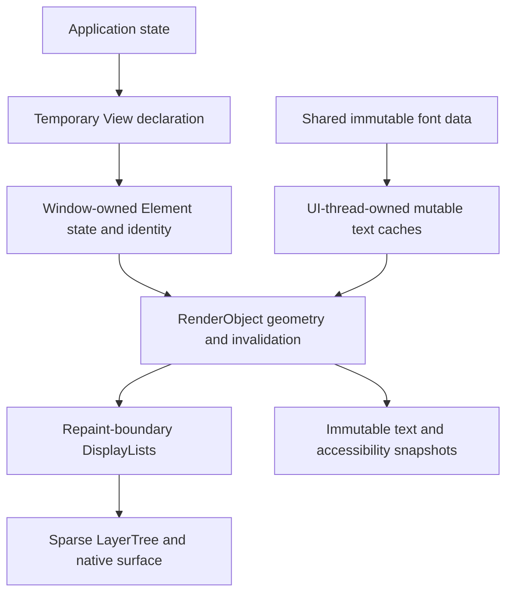

# Memory ownership and rendering budgets

ZSUI uses explicit ownership, short borrows and bounded reusable storage to
reduce duplicate allocations without weakening native text, input or
accessibility behavior. `Arc` and synchronization remain appropriate where
data crosses a real lifetime or thread boundary. Removing those boundaries
requires a separate design and target proof.

## Implemented Windows lifecycle

Ordinary Win32 painting composites Rust text directly into the top-down
`BeginBufferedPaint` DIB through `GetBufferedPaintBits`. A private
`WindowsBufferedTextSurface<'paint>` borrows the paint owner exclusively.
The Rust pixel slice exists only during composition, after `GdiFlush`;
native drawing resumes after the slice is released. `EndBufferedPaint`
presents the completed frame and background erase remains suppressed.

The borrowed pixels belong to the paint buffer, not DWM's private compositor
storage. The full-window paint buffer still exists. At 1080 x 760, one
32-bit surface alone occupies approximately 3.13 MiB before stride padding.

Native DCs without accessible pixels and nonrectangular clips use a reusable
512 x 64 BGRA scratch tile, capped at 128 KiB per renderer. Background copy,
text composition and presentation happen per tile. Rectangular direct writes
intersect the current clip and text bounds; the GDI fallback preserves holes
in complex clipping regions. Overflowing ellipsis retains the existing native
text fallback.

For windows opting into `release_view_when_hidden()`, suspension also drops
the renderer's text engine, layout/glyph caches, scratch bitmap and cached
GDI objects. The application state and command delivery remain alive;
restoration lazily reconstructs rendering resources. Each window continues
to own its text context, so hiding one cannot clear another window's cache.

Win32 aggregate dispatch reports retain counters for all events but bound
diagnostic histories: 256 ordinary entries, 64 errors, 512 bytes per trace and
4096 bytes per error. First/recent evidence and an explicit truncation marker
remain available. These limits apply to diagnostics, not accepted commands,
input dispatch or application data.

## Windows measurements

The release probe uses a 1080 x 760 window, fixed panel and multilingual
large-text scenes, three processes per scene and seven samples per phase
per process. Values below are medians in MiB. No working-set trimming is
used. The machine-readable report records source and executable hashes:
[`quality/windows-memory-lifecycle.json`](quality/windows-memory-lifecycle.json).

| Scene and phase | Baseline private | Optimized private | Baseline resident | Optimized resident |
| --- | ---: | ---: | ---: | ---: |
| Panel, visible | 9.44 | 8.77 | 28.05 | 26.25 |
| Panel, hidden | 6.30 | 3.35 | 24.97 | 20.92 |
| Panel, restored | 6.33 | 5.76 | 25.03 | 23.22 |
| Large text, visible | 11.67 | 8.96 | 30.25 | 24.14 |
| Large text, hidden | 8.54 | 3.39 | 27.17 | 18.59 |
| Large text, restored | 8.57 | 5.97 | 27.23 | 23.37 |

Six accepted pairs of restored full-window captures are byte-identical after
RGBA decoding. This proves those fixed final surfaces; it does not prove
every intermediate frame, DPI, font, animation or multiwindow scenario.
Phase labels follow the scripted command sequence and settling intervals;
the probe does not sample `IsWindowVisible` with each memory sample.

Private bytes measure committed private process memory. Resident bytes include
resident shared/image pages as well as private pages. Cache byte counters
measure a narrower category and are not interchangeable with either process
metric. Dropping Rust owners releases allocations to the allocator; immediate
return of all pages to the operating system is not guaranteed.

## Retained architecture contract

The planned retained model separates declaration, identity, layout and
presentation. These layers are a migration target, not a claim that the
current `ViewNode` implementation has already been replaced.

The ownership rules for this migration are:

| Data | Owner and borrowing contract |
| --- | --- |
| Application values | Application state; hiding a window does not discard values or accepted work |
| Widget identity and interaction | Window-owned Element storage; reconcile by type and explicit stable key |
| Geometry and paint invalidation | RenderObject storage; invalidate only affected subtrees and repaint boundaries |
| Text source and shaped geometry | Immutable retained text record shared by measure, paint, caret and accessibility |
| Draw commands | Stable text/resource IDs or an owned immutable frame; no references into a temporary View |
| Font files and face metadata | Immutable shared handles with owned mapping lifetime and explicit font revision |
| Mutable glyph atlas and scratch | UI-thread rendering context with bounded resident bytes and explicit trim policy |
| Native accessibility | Validated IDs and immutable snapshots, or a defined UI-thread dispatch protocol |

An immutable `Arc<str>` or `Arc<ShapedText>` can share one allocation between
a retained node, a frame and accessibility. A borrowed `&str` is suitable
inside a short paint call. A stored self-reference into a movable arena is
not a replacement for ownership. Literal text can use `&'static str`, but
pointer equality is only a fast positive check; content and relevant layout
properties must still determine equivalence. Fingerprints require collision
checking or collision-free identity/revision validation.

## Constraints on compact storage

**Text geometry.** A glyph ID plus x coordinate and cluster start is not a
complete shaped glyph. Mixed fonts, y offsets, advances, cluster ranges,
bidirectional runs, synthetic bold, variable axes, physical raster phase and
line metrics affect painting or selection. Store properties common to a run
once, then measure compact per-glyph representations. Keep exact shaper
geometry separate from raster quantization. A 10-12-byte glyph target or
26.6 fixed point is not an accepted replacement until overflow, caret, IME,
multilingual and pixel tests establish its accuracy.

**Font metadata.** Compact family/file IDs can remove duplicated strings, but
font collections, aliases/localized names, fallback coverage, style, stretch,
weight and variable axes remain represented. An eight-byte face record is
not a complete font index. A memory map must have an owner; casting its
borrow to `&'static [u8]` would hide its lifetime and prevent reliable cleanup.

**Glyph atlas.** Pages can reduce allocation overhead, with separate budgets
for grayscale, subpixel masks and color glyphs. Budget page storage, metadata,
fragmentation and oversized-glyph fallback together. `u8` width/height cannot
represent a 256-pixel extent; eight-bit generations can wrap after 256
reuses. Use checked dimensions and generations, and validate the complete
font/face/axis/size/phase/render-mode key rather than treating an unchecked
64-bit hash as unique. Pin pages used by an active frame or re-resolve stale
handles before paint. One window must not advance another's eviction epoch.

**Element arena.** A columnar arena may reduce common node overhead, but a
four-byte index alone does not reject stale references after reuse. Keep
generation-aware internal IDs distinct from public stable `WidgetId` values.
Measure sparse maps, capacities, callbacks and specialized state as well as
common columns. Four focus/hover IDs do not account for text selection, IME,
scroll, drag, capture and platform interaction state.

**Threads and accessibility.** The current Windows text-shaper boundary is
`Send + Sync`, and UIA providers expose `ProviderOptions_ServerSideProvider`
without `ProviderOptions_UseComThreading`. COM callbacks cannot directly
borrow an unsynchronized UI-thread arena. An immutable snapshot or explicit
marshaling protocol must preserve text ranges, stale-ID rejection and close
behavior before locks can be removed. Do not hold rendering locks across
native callbacks or synchronous UI-thread requests. A future thread-local
renderer can use a structural `!Send`/`!Sync` marker, while workers retain the
typed invalidation/command channel.

## Budget model and rollout gates

Total memory is the sum of shared font data, per-window state, retained text,
bounded caches, native surfaces, frame scratch and allocator/runtime costs.
Some terms depend on window count, DPI, visible content or surface dimensions.
Cache caps must not be advertised as a fixed process-wide 1 MiB limit.

1. **Direct pixel composition and hidden-window release:** implemented in the
   Windows path with bounded fallback tiles and fixed-scene target evidence.
2. **Text-source and layout sharing:** remove duplicate owned strings and
   geometry while keeping immutable frame and accessibility lifetimes; test
   edits, selection, IME, dropped frames and hidden restoration.
3. **Shared font storage and UI-thread caches:** split read-only font data
   from mutable caches, define thread ownership and multiwindow eviction, and
   test mixed DPI plus concurrent accessibility before reducing synchronization.
4. **Paged glyph storage:** retain full raster keys, color glyph support and
   stale-handle safety; compare memory, cache misses and frame-time percentiles.
5. **Dirty subtrees and tiled presentation:** prove invalidation, transparency,
   effects, occlusion, scrolling and resize damage before replacing whole-frame
   presentation. A completed tile is not an atomic completed frame.
6. **Compact Element/RenderObject storage:** preserve stable identities and
   behavior first, then compare arena layouts against representative workloads.

Each gate requires controlled before/after release measurements and unchanged
text/input/accessibility semantics. Small scratch storage alone does not
justify slower scrolling, repeated font discovery or increased frame peaks.

## Related implementations and platform contracts

- [egui's font implementation](https://github.com/emilk/egui/blob/main/crates/epaint/src/text/fonts.rs)
  shares font/atlas machinery while maintaining viewport-specific galley cache
  lifecycles. Shared storage and separate eviction ownership can coexist.
- [iced's text implementation](https://github.com/iced-rs/iced/blob/master/graphics/src/text.rs)
  uses a shared font system behind `OnceLock<RwLock<FontSystem>>`; synchronization
  is not inherently incompatible with Rust ownership.
- [Slint's software renderer](https://docs.slint.dev/latest/docs/rust/slint/platform/software_renderer/struct.SoftwareRenderer)
  supports full-buffer and line-by-line rendering, with the latter intended for
  devices lacking a complete frame buffer. It establishes a useful memory
  technique, not proof of Windows desktop presentation equivalence.
- [GetBufferedPaintBits](https://learn.microsoft.com/en-us/windows/win32/api/uxtheme/nf-uxtheme-getbufferedpaintbits)
  exposes a DIB owned by the buffered-paint operation.
- [UIA provider threading options](https://learn.microsoft.com/en-us/windows/win32/api/uiautomationcore/ne-uiautomationcore-provideroptions)
  define callback threading independently of a framework's Rust object model.
- [Rust allocation and capacity behavior](https://doc.rust-lang.org/std/vec/struct.Vec.html)
  distinguishes logical length, retained capacity and allocator behavior.
